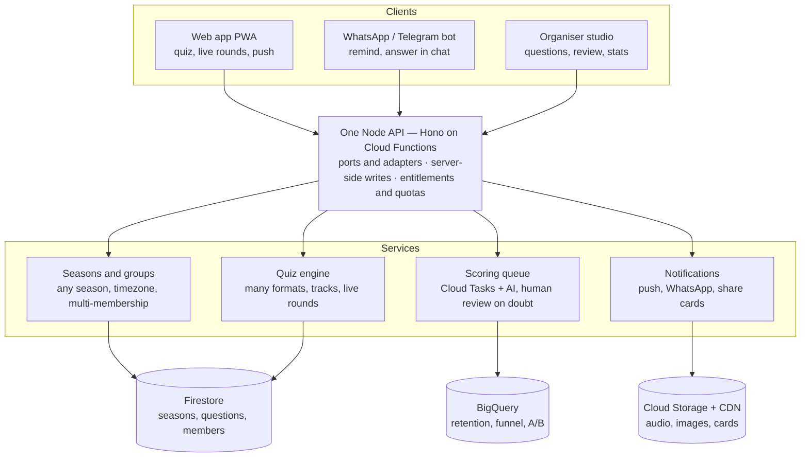
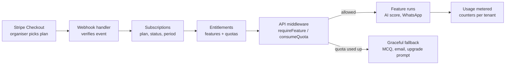
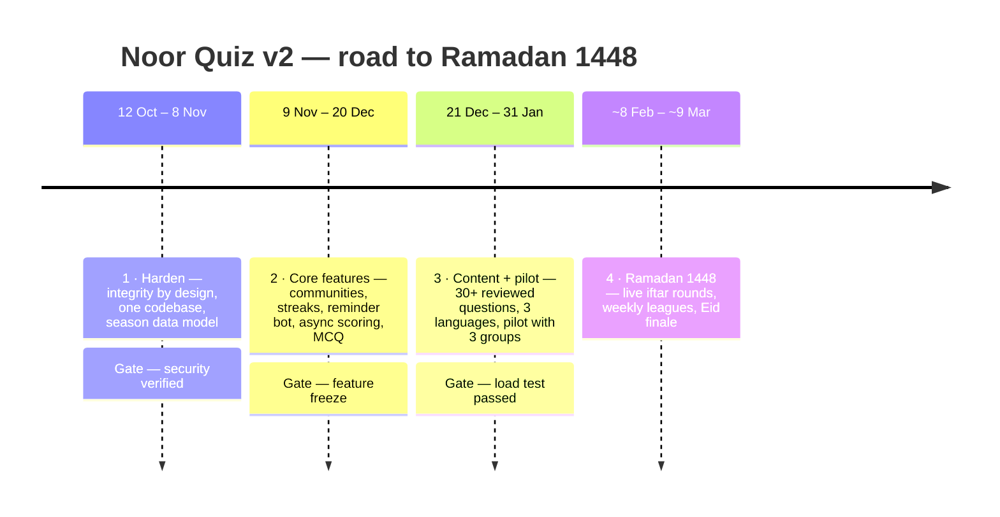

# Noor Quiz — Review & Vision

Oct 11, 2026 · Hassen Mohammed

> Exported from the living Claude Doc "Ramadan Q&A 2.0 — Review & Vision". Diagrams are re-drawn here as Mermaid.
> Sections "What exists today" and "Fix before next season" describe the **old** `ramadan` project and are kept as lessons learned.

## TL;DR

Turn last year's one-question-a-day quiz into a **multi-tenant community learning platform**: any mosque, family, school or workplace spins up its own space, Ramadan is the flagship season, and smaller seasons (Dhul Hijjah, Muharram, weekly Jumu'ah) keep people coming back all year.

Next Ramadan starts around 8 Feb 2027 (moon-sighting dependent), so there are roughly 17 weeks. That is enough for a solid v2 if we start with the three things below:

1. **Close the integrity holes first.** In the old app a user can make themselves admin from the browser, read every answer key, and see today's correct answer through a test-mode URL. Any growth makes these worse.
2. **Re-model around seasons and communities.** Quizzes were hard-wired to "day 1–30", one timezone, one group per user, admin-created group codes. Making `season` and `community` first-class unlocks almost every idea in this doc.
3. **Add the habit loop.** Streaks, reminders via WhatsApp/Telegram/push, instant feedback, and a shareable daily card. These are what turn a nice quiz into something people open every iftar.

The big idea: keep the daily question as the heartbeat, and surround it with live iftar rounds, team (group-vs-group) leagues, family modes for kids, and a reflection/good-deeds layer, all delivered where people already are (WhatsApp, Telegram) rather than only a web app.

## What exists today (old `ramadan` project)

The app is a clean, working MVP: Google sign-in, one open-ended question per day, AI scoring with warm feedback, and per-group plus group-vs-group leaderboards. The AI-feedback idea is the strongest part and worth keeping at the centre.

| Area | Today | Limit for v2 |
| --- | --- | --- |
| Stack | Next.js 16 + Firebase (Auth, Firestore), deployed via Hosting web-frameworks; a second full port in `furnished/` (Vite + Cloud Functions) | Two codebases doing the same thing will drift; pick one |
| Content | 30 questions in `data.json`, one per day, free-text answers (max 800 chars) | Single format; no categories, difficulty, sources or languages |
| Time model | Ramadan day from the Umm al-Qura calendar; fixed `Europe/Stockholm`; submissions close 20:00 | Users in other countries get the wrong day/cutoff; no local moon-sighting control per community |
| Data model | `quizzes/{day}`, `answers/{uid_day}`, `leaderboards/{group}` | No season, so next year overwrites last year; history is lost |
| Groups | Admin creates codes; user joins exactly one, permanently; nickname permanent, ASCII only | No self-serve communities; Arabic, Amharic or Somali names are rejected |
| Scoring | Cron every 15 min scores the day after 20:00, one AI call per answer, sequentially | Will time out at a few thousand answers; no human review queue |
| Admin | Single admin from env var; create quiz, score, review, reset | No roles (community admin, content editor, scholar reviewer) |
| Engagement | Calendar, countdown, past results | No reminders, streaks, sharing, or anything outside the daily question |

What worked and should stay: a single daily ritual, the encouraging AI feedback, the gap between answering and seeing the result (anticipation), and group rivalry.

## Fix before next season (lessons from the old app)

Five issues would let a motivated user top any leaderboard. The new design must make each of them impossible by construction.

| # | Issue | Where (old repo) | Fix / rule in v2 |
| --- | --- | --- | --- |
| 1 | **Self-promotion to admin.** The users `create` rule does not check `role`, so a user can create their own doc with `role: "admin"` and then read `quizKeys` and write quizzes | `firestore.rules`, `match /users/{uid}` | Roles live server-side only (memberships + custom claims); clients never write user docs |
| 2 | **Today's answer leaks via test mode.** `/api/quiz-details?day=N&testMode=true&testDay=30` passes the "day has ended" check for any day | `src/app/api/quiz-details/route.ts` | Time comes from a server `Clock` port; no client-controlled overrides exist in production builds |
| 3 | **Submit for any day.** `/api/answers` merges client-sent `overrides` | `src/app/api/answers/route.ts` | Same: server clock only |
| 4 | **Direct Firestore writes bypass the API**, with any `groupCode` | `firestore.rules` answers + users | All writes through the API; rules deny every client write |
| 5 | **Answer can be edited after peeking** | design | Score the first submission, or lock after submit (per question type) |

Also:

- **Secrets hygiene.** Firebase private key and AI keys go to Secret Manager / function secrets; never in `.env` files committed or copied around.
- **Content accuracy.** Questions and "correct answers" are religious claims. Every question needs a source and a scholar-review status before publishing.
- **Prompt injection in answers.** Answers are untrusted data inside the AI prompt: delimit them, validate output, and flag outliers for human review.

## Scalability and architecture

Keep Firebase, but consolidate to one backend and make scoring asynchronous so 10,000+ answers a day cost little and never time out.

Every client goes through one API; scoring and notifications run as background jobs, so the evening reveal never waits on AI calls.

- **One codebase.** A fresh monorepo (this repo). The old Next.js and `furnished/` code are reference only.
- **Season-scoped data.** `seasons/{seasonId}`, `questions/{questionId}` (with `seasonId`), `communities/{id}`, `memberships/{userId_communityId}`, `answers/{questionId_userId}`. History is kept and each season has its own length, start date and moon-sighting override.
- **Per-user timezone.** A question opens and closes in the season's/community's timezone and configured times.
- **Async scoring.** On submit, enqueue a task; workers score in parallel with retries and a per-day budget cap. Cache identical normalised answers. Multiple-choice is scored instantly with no AI cost.
- **Sharded leaderboards.** Distributed counters or periodic rollups instead of one hot doc per group.
- **Observability.** Error tracking, AI cost per day, and a participation dashboard.

## Tech stack

Node + Vite + Firebase. To avoid being trapped, the rule is simple: **business logic never imports Firebase or a vendor SDK.** It talks to small interfaces we own (ports), and Firebase, Stripe or an AI provider sit behind adapters that can be swapped one at a time.

### Shape of the code

One TypeScript monorepo (npm workspaces):

- `packages/core` — the domain: seasons, questions, answers, scoring rules, streaks, leagues, plans and entitlements. Pure TypeScript, no I/O, fully unit-tested.
- `packages/contracts` — zod schemas and types shared by API and web, so request/response shapes are defined once.
- `apps/api` — Node 22 HTTP API on **Hono** (standard `Request`/`Response`, runs on Cloud Functions, Cloud Run or any Node host). Adapters live here.
- `apps/web` — Vite + React + React Router. Talks only to our API, plus a thin realtime adapter for live leaderboards.
- `apps/workers` — scoring, notifications and rollups, triggered by queue tasks and schedules.

### Ports and where they plug in

| Port (our interface) | Adapter today | Exit path later |
| --- | --- | --- |
| `AuthVerifier` | Firebase Auth ID tokens (standard JWT) | Any OIDC provider (Auth0, Keycloak, Supabase) |
| Repositories (`QuestionRepo`, `AnswerRepo`, `TenantRepo`…) | Firestore | PostgreSQL (Cloud SQL) when relational reporting grows |
| `Realtime` (client side) | Firestore listeners, read-only | Server-sent events from the API |
| `Queue` / `Scheduler` | Cloud Tasks + Cloud Scheduler | BullMQ/Redis, SQS |
| `AiScorer` | OpenAI / Gemini / Claude, chosen per tenant by config | Any provider or a self-hosted model |
| `Notifier` | FCM web push, WhatsApp Cloud API (Meta direct), Telegram Bot API, email | Swap per channel |
| `BlobStore` | Cloud Storage | S3-compatible storage |
| `PaymentProvider` | Stripe | Paddle, Adyen, Swish via a Swedish PSP |
| `Clock` | System time + timezone | Fake clock in tests (the only "test mode") |

### Rules that keep us free

- **Server-only writes.** The browser never writes to Firestore; rules allow reads of public leaderboard docs only.
- **Own the IDs.** Our own `userId` and `tenantId`; the Firebase uid is just a linked identity.
- **Portable data shapes.** Flat documents with stable IDs and explicit foreign keys, so every collection maps 1:1 to a SQL table. Nightly export as a vendor-neutral backup.
- **Few, boring dependencies.** React, React Router, zod, Hono, a tiny i18n layer over `Intl`, Vitest, Playwright. No UI kit: our own small component set with CSS variables. Every new dependency needs a reason and an exit.
- **Prompts and AI config in the repo,** versioned, with JSON output validated by zod regardless of provider.
- **Environments as separate Firebase projects** (dev, staging, prod), deployed from GitHub Actions; secrets in Secret Manager; the Firebase Emulator Suite runs adapter tests locally.

### Multi-tenant from day one

- Every document carries `tenantId`; every repository call requires it.
- Roles per tenant (owner, admin, editor, scholar-reviewer, member) live in `memberships`, checked by API middleware. Custom claims hold only platform-level flags.
- Tenant export (all their data as JSON/CSV) is a built-in feature.

## Subscription model

Free for every individual learner; charge the **organisers** (communities). Paid tiers are built around the two things that actually cost money: AI scoring and WhatsApp messages.

| Plan | Who | Includes | Paid by |
| --- | --- | --- | --- |
| Free | Families, small study circles | Global season, small member cap, multiple-choice rounds, basic leaderboard, push and email reminders, monthly AI-feedback allowance | — |
| Community | Mosques, schools, student associations | Own questions and season calendar, larger member cap, AI scoring for all answers, WhatsApp/Telegram reminders (quota), sub-groups and leagues, live iftar rounds, branding, analytics | Monthly, yearly, or one-off **Season pass** |
| Organisation | Federations, school networks, companies | Many communities under one account, white-label domain, scholar-review workflow, data export/API, higher quotas, priority support | Yearly contract |
| Supporter (optional) | Individuals | Badge, early access; funds free communities | Monthly, pay what you want |
| Sponsored seat | Donors, local businesses | Pays a community's plan as sadaqah | One-off |

Prices are set after the January pilot, once cost per active member per season is known; until then tiers carry limits, not numbers.

### Built into the design, not bolted on

- **Plans as data.** A `plans` collection maps each plan to features (`ai_scoring`, `whatsapp`, `custom_questions`, `white_label`…) and limits. Changing a limit is a data change, not a deploy.
- **Entitlements, our source of truth.** The API checks `entitlements/{tenantId}` via `requireFeature()` and `consumeQuota()`. The app never asks Stripe at request time.
- **Usage metering.** Every AI call and outbound message writes a usage event; a rollup keeps per-tenant counters.
- **Graceful limits.** When a quota runs out the season keeps working: AI scoring falls back to multiple choice or queued human review, WhatsApp falls back to push/email, the admin gets an upgrade prompt.
- **Seasonal billing.** Season pass covers Ramadan plus Eid; yearly includes smaller seasons.
- **Billing webhooks only.** Stripe Checkout + Customer Portal handle cards, receipts and VAT (Stripe Tax); a webhook updates `subscriptions` and recomputes entitlements.

Open decision: legal entity (non-profit association or company) — needed before live payments, not before building. Target: decide by mid-December 2026.

## Feature ideas

The daily question stays the heartbeat; everything else gives people a reason to open the app at a second moment of the day, or to bring someone else in.

### 1. The habit loop (highest impact, lowest effort)

- **Streaks with mercy.** Daily streak plus one "qada" make-up token per week.
- **Reminders where people live.** WhatsApp/Telegram bot and web push at a chosen time; answer straight from the chat.
- **Instant partial feedback.** Multiple-choice shows right/wrong immediately; the AI-scored reflection question waits for the evening reveal.
- **Shareable daily card.** Auto-generated image with an invite link.
- **Evening reveal moment.** At cutoff, push the correct answer, a short explainer and the group's ranking change.

### 2. New game modes

- **Live iftar round.** 10-minute Kahoot-style live quiz with speed points and a projector view.
- **Multiple formats.** Multiple choice, true/false, ordering, audio (identify the surah), fill-in-the-ayah, image questions.
- **Difficulty tracks.** Beginner / intermediate / scholar.
- **Laylat al-Qadr special.** Bonus challenges on odd nights of the last ten.
- **Duels.** Challenge a friend to the same 5 questions.
- **Season finale.** Eid-eve final for each community's top players.

### 3. Community and competition

- **Self-serve communities** with invite link / QR.
- **Multi-membership** (family + mosque + workplace).
- **Fair group ranking** by average score and participation rate.
- **Leagues** with weekly promotion/relegation.
- **Discussion after reveal**, moderated.

### 4. Beyond the quiz: the Ramadan companion

- **Good deeds tracker** (private by design).
- **Quran khatm together** — a group splits the 30 juz.
- **Community charity goal** matched by a sponsor.
- **Prayer and iftar times** per location.

### 5. AI that adds real value

- **Personal tutor** grounded only in vetted sources.
- **Question studio** — AI drafts, scholar approves.
- **Batch, cached scoring** with a human queue for low confidence.
- **Multilingual** — English, Arabic, Amharic, Somali, Swedish and more.

### 6. Kids and families

- **Kids mode** — pictures, audio, parent-managed profiles, no public leaderboard.
- **Family board** — shared streak, printable Eid certificate.

## Beyond Ramadan

| Season | When (approx.) | Format idea |
| --- | --- | --- |
| Ramadan | 30 days | Flagship: daily question, live iftar rounds, finale |
| First 10 of Dhul Hijjah | 10 days | Hajj and sacrifice themes, daily deeds challenge |
| Muharram / Ashura | 10 days | Stories of the prophets, history |
| Weekly Jumu'ah quiz | Every Friday | 5 questions tied to Surah al-Kahf or the khutbah topic |
| Seerah journey | 12 weeks | One chapter a week, certificate at the end |
| Learning paths | Self-paced | Short courses with mastery checks |

- **Platform for organisers** — white-label spaces; one imam onboarding brings hundreds of users.
- **Sustainability** — free for users, funded by organiser plans and sponsor-matched goals. No ads in a worship context.

## Roadmap and metrics

Anything not done by the feature freeze moves to the Dhul Hijjah season.

| Metric | Why it matters |
| --- | --- |
| Daily active / registered | Is the daily ritual sticking? |
| Day-7 and day-20 retention | Ramadan drop-off usually hits mid-month |
| Average streak length | Direct read on the habit loop |
| Invites sent and accepted per user | Viral growth |
| Communities created (self-serve) | Distribution beyond your own groups |
| AI cost per 1,000 answers | Keeps scale affordable |
| Score disputes / human overrides | Trust in AI scoring |
| Return rate in the next season | Proof it works beyond Ramadan |
